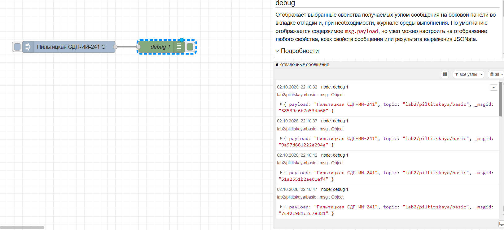
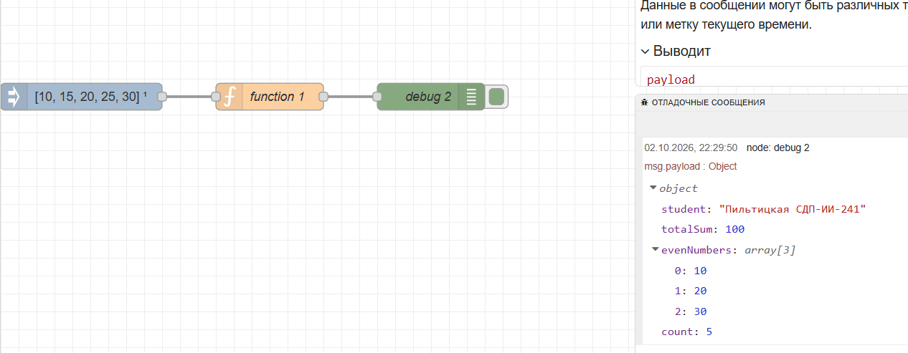
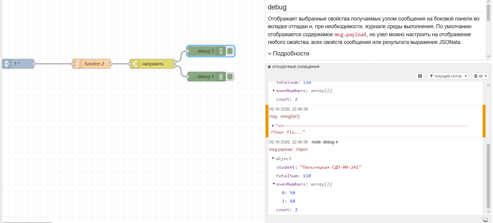
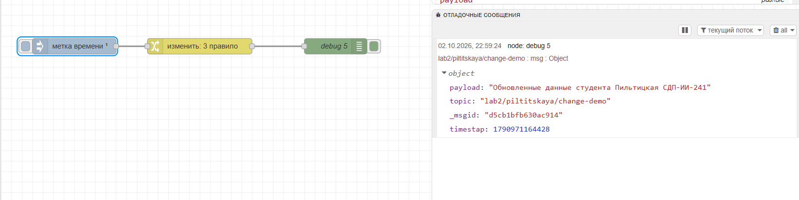
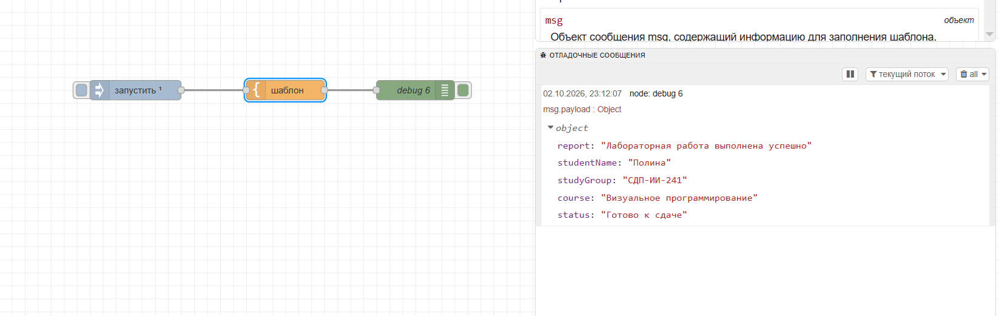
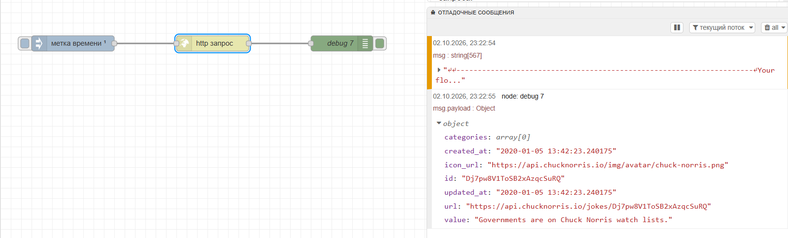
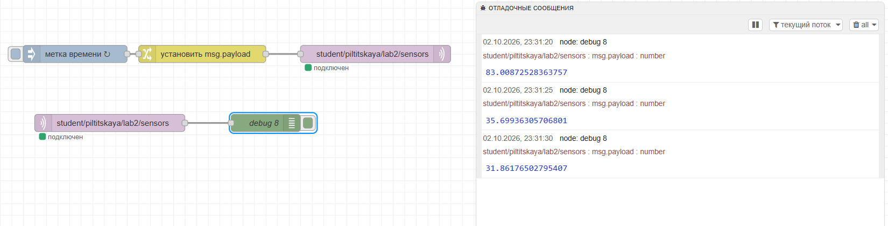
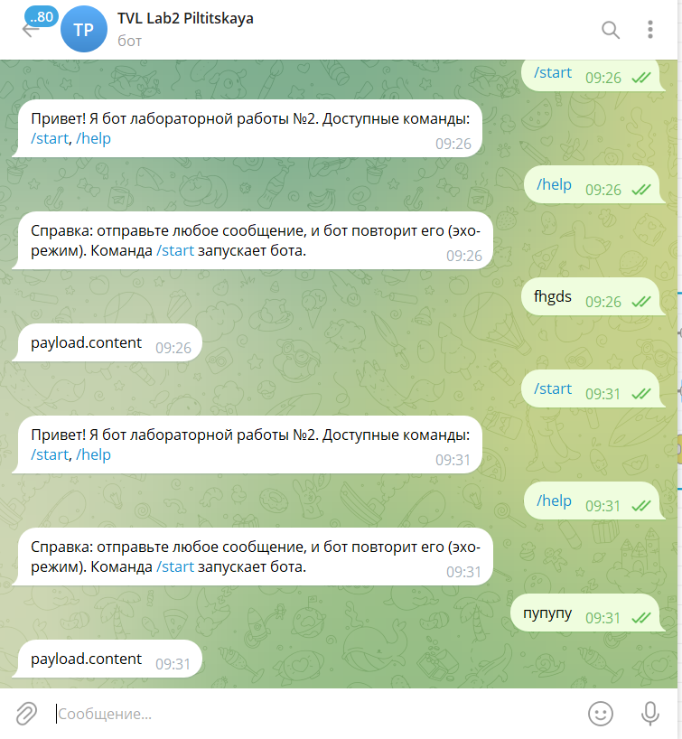
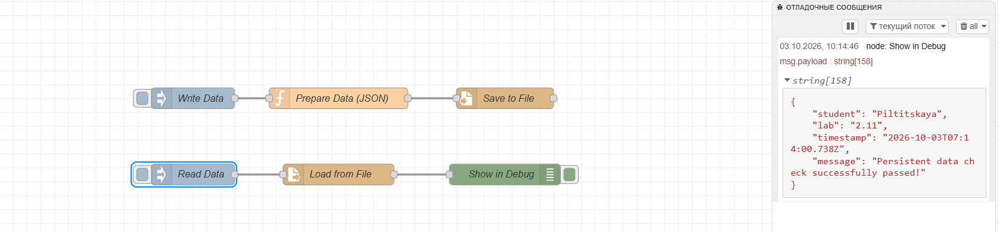
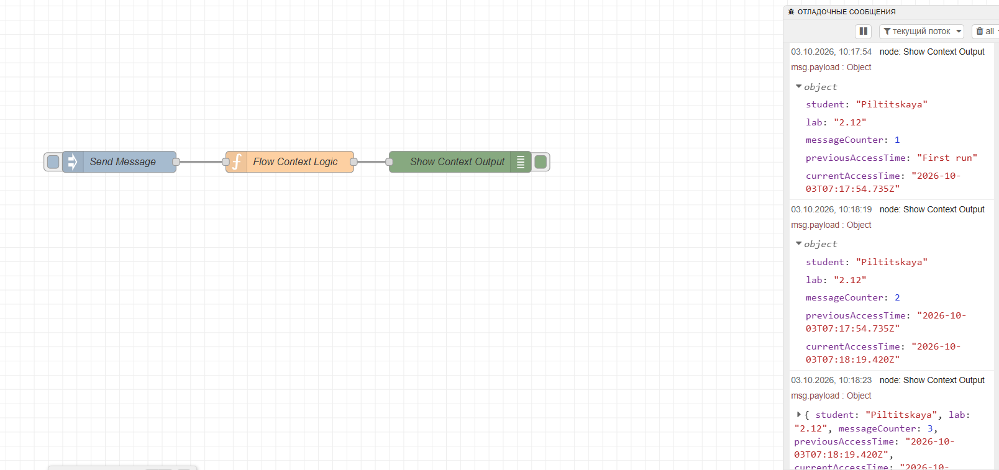

# Отчёт по лабораторной работе №2: Node-RED
**Студент:** Пильтицкая Полина (Группа: СДП-ИИ-241)

---

## 1. Краткое описание выполненного
В ходе выполнения лабораторной работы был освоен инструмент визуального программирования Node-RED как low-code платформа. Были успешно развернуты контейнеры с помощью Docker, настроено персистентное хранение данных, а также создано 12 различных потоков (`flow-*.json`), охватывающих базовые ноды, логику ветвления, работу с внешними REST API, MQTT-брокерами, HTTP-эндпоинтами, Dashboard, Telegram-ботом, файловой системой и контекстом выполнения.

## 2. Использованные AI-промпты
Для генерации JS-кода в нодах Function, шаблонов Mustache и проверки логики эндпоинтов использовались следующие примеры промптов:
- *Для Function node (2.2):* «Напиши JavaScript код для ноды Function в Node-RED, который принимает массив чисел в `msg.payload`, вычисляет их общую сумму с помощью цикла `for`, находит четные числа и возвращает объект с полями `student`, `totalSum`, `evenNumbers` и `count`».
- *Для Template node (2.5):* «Составь Mustache-шаблон для Node-RED, который формирует аккуратный JSON-отчет с полями статуса, имени студента и группы на основе входящего объекта».
- *Для эндпоинтов (2.8):* «Сгенерируй скрипт проверки для Node-RED эндпоинта, который считывает query-параметр `id`, и если параметр отсутствует — возвращает статус 400 и ошибку, если больше 10 — статус 404, а иначе успешный JSON со статусом 200».

## 3. Освоенные ноды
В работе были задействованы и изучены следующие типы нод:
- **Core:** `inject`, `debug`, `function`, `switch`, `change`, `template`, `comment`.
- **Network / API:** `http request`, `http in`, `http response`, `mqtt in`, `mqtt out`.
- **Storage / Context:** `file in`, `file out`, а также механизмы flow/global контекста.
- **Dashboard:** `ui_group`, `ui_tab`, `ui_gauge`, `ui_chart`.
- **External Integrations:** `telegram receiver`, `telegram sender` (`node-red-contrib-telegrambot`).

## 4. Способ установки и версии окружения
- **Способ установки:** Docker / Docker Desktop (`nodered/node-red:latest`).
- **Монтирование тома:** Локальная папка привязана к `/data` внутри контейнера для сохранения потоков (`-v C:/node-red-data:/data`).
- **Порт:** `1880`.
- **Версия Node-RED:** v4.0.x (или актуальная в Docker-образе).
- **Версия Node.js:** v20.x / v22.x (проверено через логи запуска Docker Desktop и команду `node -v`).

## 5. Скриншоты потоков и результатов (по порядку задания)

- **2.1. Inject → Debug:**
  

- **2.2. Function node:**
  

- **2.3. Switch node:**
  

- **2.4. Change / Set node:**
  

- **2.5. Template node:**
  

- **2.6. HTTP Request node:**
  

- **2.7. MQTT с публичным брокером:**
  

- **2.8. GET-эндпоинты:**  
  *(Скриншоты работы с эндпоинтами в браузере)*
  

- **2.9. Dashboard с gauge и графиком:**  
  *(Скриншоты интерфейса дашборда)*
  

- **2.10. Telegram-бот:**
  

- **2.11. Чтение и запись файла:**
  

- **2.12. Работа с контекстом:**
  

- **Выполненная ачивка (Dashboard forms):**
  

## 6. Выводы
Node-RED показал себя  интуитивно понятным low-code инструментом для быстрой интеграции различных сервисов, датчиков и API. Использование визуальных связей в сочетании с возможностью гибкой настройки через JavaScript (Function nodes) и шаблонизаторы позволяет эффективно решать задачи автоматизации и обработки данных.